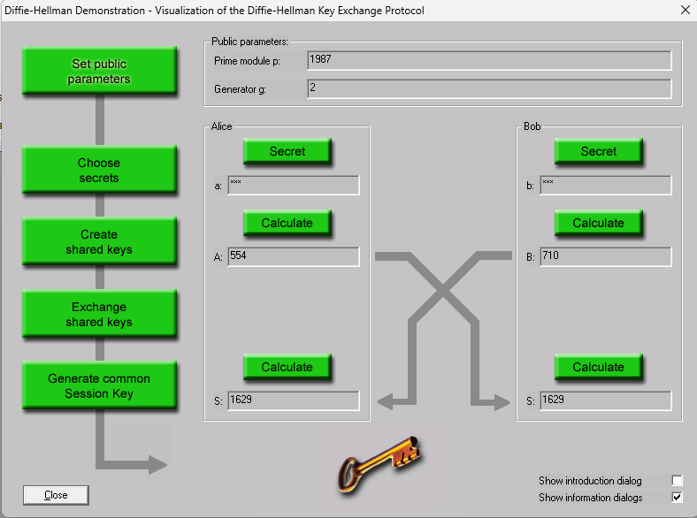

## Ejercicio 2

Utilizando la opción "Demostración Diffie-Hellman" en CrypTool 1, generad una clave D&H con 1000 < p < 2000.

### Generación de la clave

En CrypTool 1: **Procedimientos individuales → Protocolos → Demostración Diffie-Hellman**. Se siguen los pasos de la demostración:

1. **Parámetros públicos.** Se elige el primo `p = 1987` (cumple 1000 < p < 2000) y el generador `g = 2`. `g = 2` es raíz primitiva módulo 1987: como `p − 1 = 1986 = 2 · 3 · 331`, se comprueba que `2^(1986/2)`, `2^(1986/3)` y `2^(1986/331)` son todos distintos de 1 (mod 1987).
2. **Secretos.** Alice elige `a = 853` y Bob `b = 554` (privados, menores que p; CrypTool los muestra ocultos como `***`).
3. **Claves compartidas (públicas).** Cada uno calcula su valor público:
   - Alice: `A = g^a mod p = 2^853 mod 1987 = 554`
   - Bob: `B = g^b mod p = 2^554 mod 1987 = 710`
4. **Intercambio.** Alice envía `A = 554` a Bob y Bob envía `B = 710` a Alice por el canal inseguro.
5. **Clave de sesión.** Cada uno combina el valor recibido con su secreto:
   - Alice: `S = B^a mod p = 710^853 mod 1987 = 1629`
   - Bob: `S = A^b mod p = 554^554 mod 1987 = 1629`

Los dos obtienen la misma clave de sesión **S = 1629** (`= g^(ab) mod p`) sin haberla transmitido nunca.

### Apartado 2.a

¿Qué utilidad puede tener la clave obtenida?

#### Respuesta 2.a

<!-- INICIO RESPUESTA -->

Diffie-Hellman no cifra ni firma nada por sí mismo: es un **protocolo de establecimiento de claves**. Su utilidad es que dos partes que no comparten ningún secreto previo obtengan un **secreto común** comunicándose por un canal inseguro, ya que un observador que ve `p`, `g`, `A` y `B` tendría que resolver el problema del logaritmo discreto para obtener `K`.

La clave obtenida (S = 1629) se usa como **clave de sesión para criptografía simétrica**:

- Para cifrar la comunicación posterior con un algoritmo simétrico (AES, ChaCha20…), mucho más rápido que el cifrado asimétrico. Así se resuelve el problema de la distribución de claves de la criptografía simétrica.
- Normalmente no se usa tal cual, sino que se pasa por una **función de derivación de claves (KDF)** o un hash para obtener claves de cifrado y de integridad (MAC/HMAC).
- Es la base del intercambio de claves en protocolos como **TLS/HTTPS, SSH, IPsec (IKE), VPN (WireGuard) o Signal**.
- Si se generan claves efímeras nuevas en cada sesión (DHE/ECDHE) se consigue **secreto perfecto hacia adelante (PFS)**: comprometer la clave privada a largo plazo de un servidor no permite descifrar sesiones pasadas.

Hay que tener en cuenta que, con `p = 1987`, la clave solo tiene unos 11 bits: sirve para la demostración, pero en la práctica se puede obtener por fuerza bruta de inmediato (ver 2.b).

<!-- FIN RESPUESTA -->

### Apartado 2.b

¿Qué problemas de seguridad pueden darse con este método? ¿Cuál sería la solución?

#### Respuesta 2.b

<!-- INICIO RESPUESTA -->

**1. Ataque de intermediario (Man-in-the-Middle).** Es el principal problema: Diffie-Hellman básico **no autentica** a las partes. Un atacante que controle el canal puede interceptar `A` y `B` y sustituirlos por su propio valor. Por ejemplo, con `m = 1111`, el atacante envía `M = 2^1111 mod 1987 = 1177` a los dos:

- Alice calcula `1177^853 mod 1987` y comparte con el atacante la clave `A^m mod p = 1737`.
- Bob calcula `1177^554 mod 1987` y comparte con el atacante la clave `B^m mod p = 276`.

Alice y Bob creen hablar entre sí, pero el atacante descifra, lee (o modifica) y vuelve a cifrar todo el tráfico sin que lo noten.

*Solución:* **autenticar el intercambio**. Los valores públicos se firman con firma digital (RSA, ECDSA) respaldada por **certificados de una PKI/CA** (es lo que hace TLS), o se usan claves precompartidas, verificación de huellas (*fingerprints*) por un canal alternativo (SSH, números de seguridad de Signal) o protocolos autenticados como STS o los de la familia MQV.

**2. Parámetros débiles (tamaño de p).** La seguridad depende de que sea inviable calcular el logaritmo discreto. Con `1000 < p < 2000` hay menos de 2000 posibles secretos y basta probar todos los exponentes hasta encontrar `a` tal que `2^a mod 1987 = 554` (fuerza bruta en milisegundos). También son débiles los grupos donde `p − 1` solo tiene factores pequeños (ataque de Pohlig-Hellman), los generadores mal elegidos (ataques de subgrupo pequeño) y la reutilización de primos estándar de 512–1024 bits (ataque Logjam, que fuerza grupos de calidad "export").

*Solución:* usar `p` de **al menos 2048 bits** (mejor 3072), **primos seguros** (`p = 2q + 1` con `q` primo) o grupos estandarizados (RFC 3526 / RFC 7919), o bien **Diffie-Hellman sobre curvas elípticas (ECDH, X25519)**, que ofrece la misma seguridad con claves mucho más pequeñas. Además, se deben **validar los valores públicos recibidos** (que `1 < A < p − 1` y que pertenezcan al subgrupo correcto).

**3. Secretos predecibles o reutilizados.** Si `a` o `b` se generan con un generador de números aleatorios débil, o se reutilizan siempre, el atacante puede adivinarlos, y si un secreto se filtra se comprometen todas las sesiones en las que se usó.

*Solución:* usar un **CSPRNG** para generar los secretos y **claves efímeras** distintas en cada sesión (DHE/ECDHE), lo que además da *Perfect Forward Secrecy*.

**4. El protocolo no ofrece integridad ni confidencialidad por sí solo.** Solo acuerda una clave; utilizar directamente `K` como clave tampoco es correcto porque no es uniformemente aleatoria.

*Solución:* derivar las claves con una **KDF (p. ej. HKDF)** y usar después un cifrado autenticado (AES-GCM, ChaCha20-Poly1305).

<!-- FIN RESPUESTA -->
