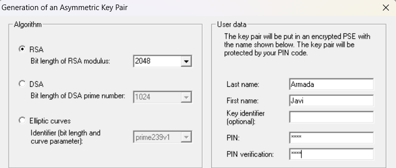
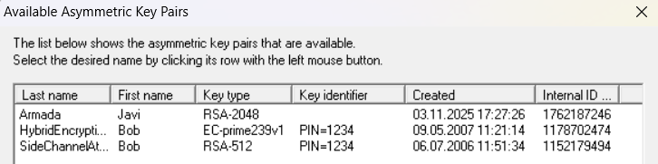
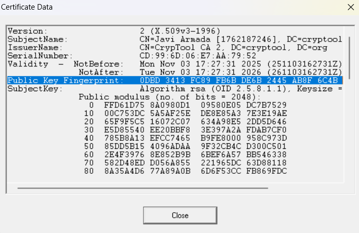
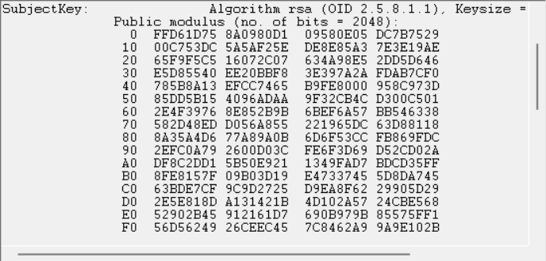
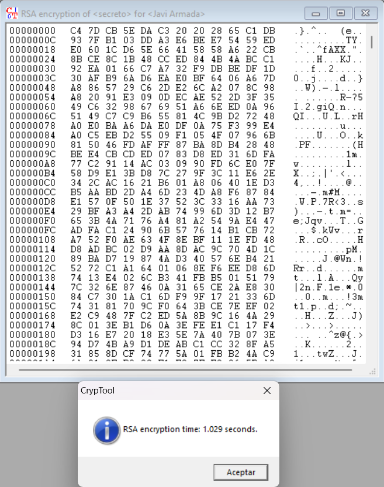
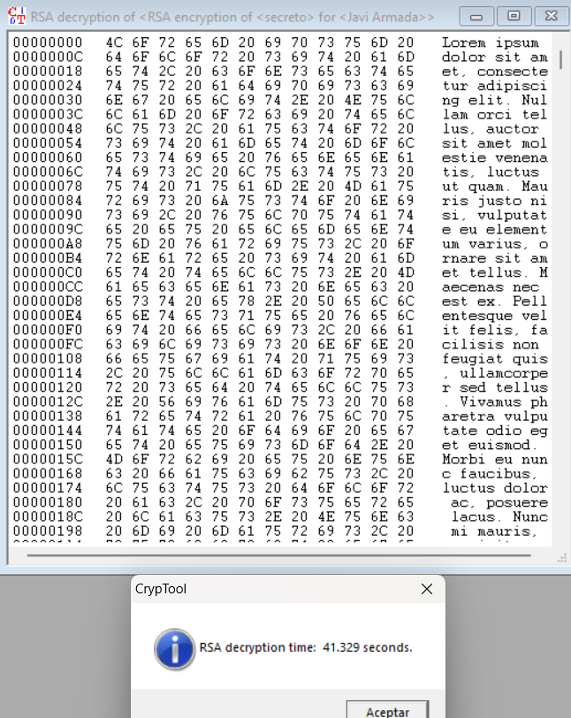

## Ejercicio 3

Utilizando la opción de "Generar/Importar Claves" de CrypTool 1, generad un par de claves RSA de 2048 bits.

### Apartado 3.a

Documentad el proceso.

#### Respuesta 3.a

<!-- INICIO RESPUESTA -->
Abrimos Cryptool y en el apartado Digital Signatures/PKI > PKI > Generate/Import Keys y ponemos los siguientes parámetros:
- RSA de 2048 bits, nombre, apellido y pin.

Una vez creado, podemos consultar la lista de nuestras claves en Digital Signatures/PKI > PKI > Display/Export Keys.

<!-- FIN RESPUESTA -->

### Apartado 3.b

¿Qué números conforman la clave pública?

#### Respuesta 3.b

<!-- INICIO RESPUESTA -->
En esa lista si seleccionamos la clave Javi Armada que acabamos de crear y le damos a show certificate y aparece ahí el módulo N. El otro parámetro que conforma la clave pública es el número `e` que vemos en la imagen.

<!-- FIN RESPUESTA -->

### Apartado 3.c

Cuando decimos que la clave es de 2048 bits, ¿a qué nos estamos refiriendo? Dicho de otra forma, ¿qué parte de la clave es la que ocupa 2048 bits?

#### Respuesta 3.c

<!-- INICIO RESPUESTA -->
Los 2048 bits son los bits que conforman el módulo público n, la multiplicación de p*q que también podemos consultar en el certificado.

<!-- FIN RESPUESTA -->

### Apartado 3.d

Realizad pruebas de cifrado y descifrado sobre el archivo `secreto.txt` disponible en Campus Virtual (Moodle). Anotad los tiempos de ejecución y comentad los resultados obtenidos. ¿Son iguales los tiempos de cifrado y descifrado? ¿A qué puede deberse? ¿Cómo son estos tiempos comparados con el cifrado simétrico (realizado en el ejercicio 10 de la práctica 1)?

#### Respuesta 3.d

<!-- INICIO RESPUESTA -->
Podemos realizar las pruebas desde Cryptool abriendo el texto `secreto.txt` dandole a Encrypt/Decrypt Asymmetric RSA. Ahí podemos apreciar que nos pide con qué clave queremos cifrar, seleccionamos el que acabamos de crear llamado Javi Armada.

Para descifrar es lo mismo pero metiendo el pin que metimos en la creación de las claves.

El cifrado dura aproximadamente 1 segundo y el descifrado 41 segundos. Esto creemos que se debe a que `e` (que es el exponente que se usa para cifrar) es elegido a propósito el 2^16+1 ya que solo tiene 2 bits a 1 y es mucho más fácil realizar operaciones con él que con `d` (exp. de descifrado) que se calcula a partir de (p-1)(q-1), que es un número infinitamente más grande que `e`.
Además son más lentos que el cifrado simétrico del ejercicio 10 donde tanto DES como AES duraban fracciones de segundo. Esto puede deberse al tipo de operaciones que se realizan en ellos, mientras en DES o AES se realizan sustituciones, permutaciones o XORs, en el cifrado asimétrico se realizan operaciones mucho más complejas (elevar y factorizar números gigantes).

<!-- FIN RESPUESTA -->
