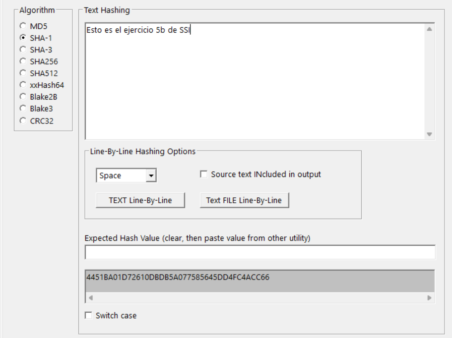
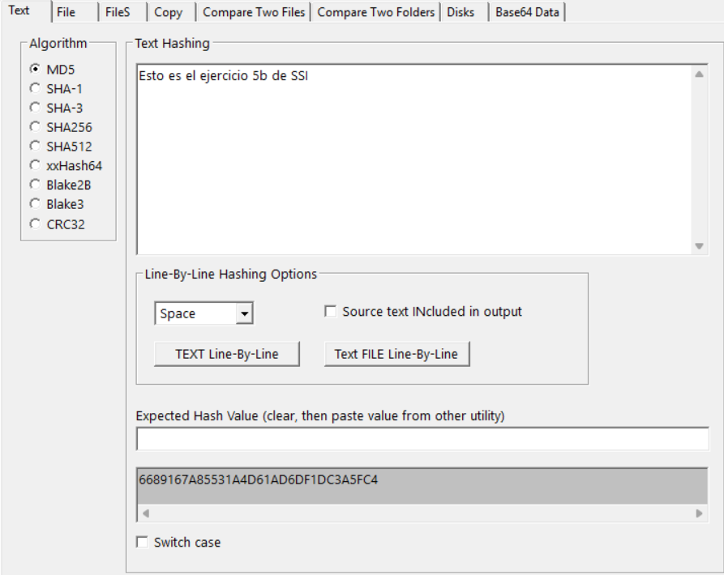
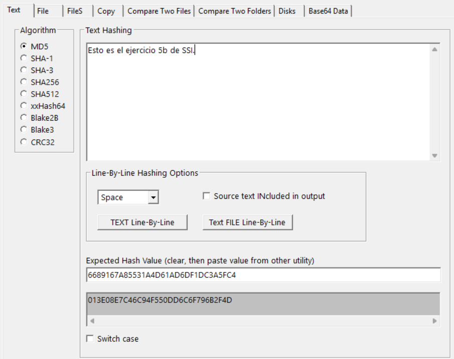
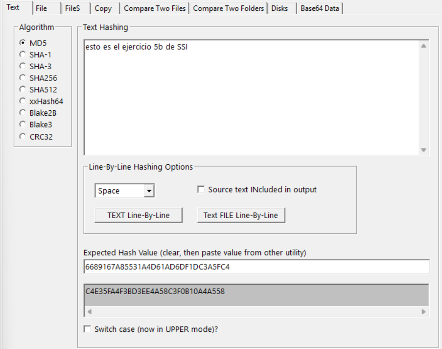
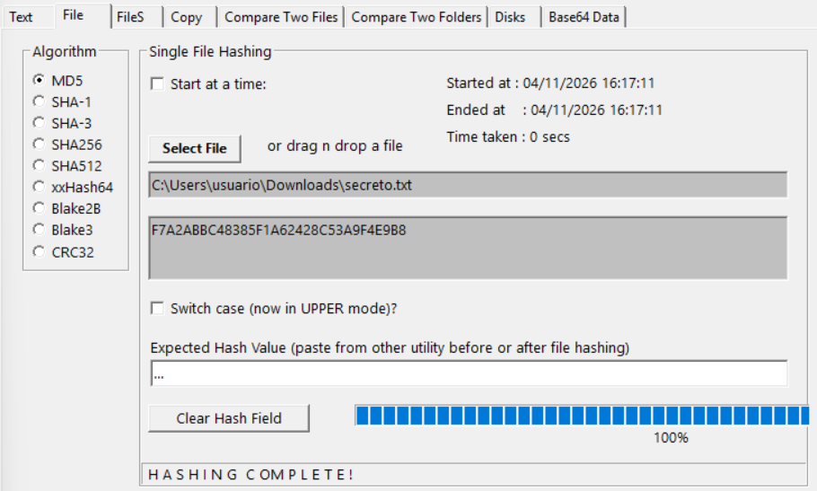
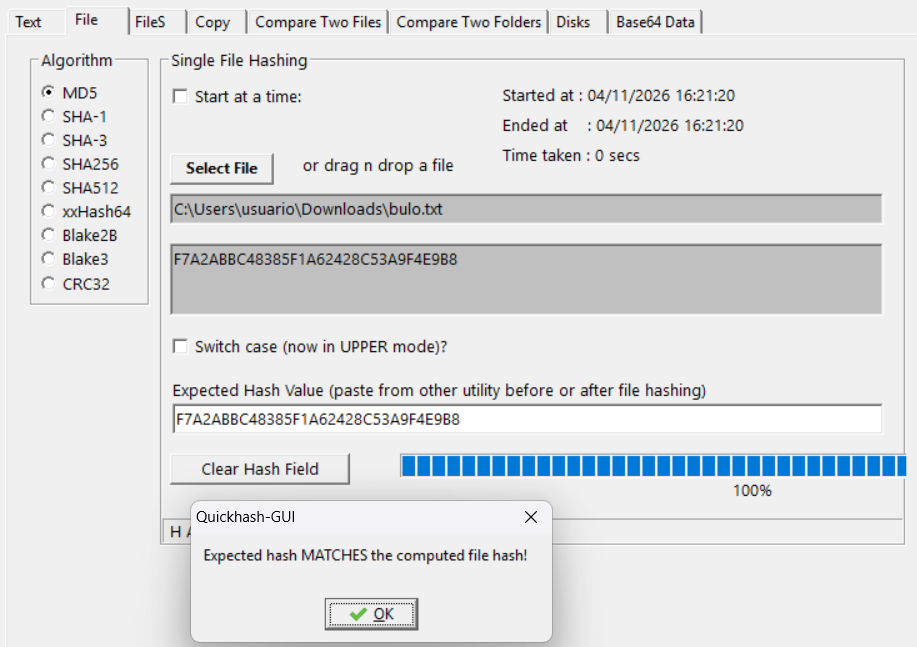

## Ejercicio 5

Herramientas para cálculo de hashes

### Apartado 5.a

Buscad, probad y documentad herramientas o comandos para calcular hashes, que estén disponibles <u>de forma nativa</u> en sistemas recientes de Windows, Linux y macOS.

#### Respuesta 5.a

<!-- INICIO RESPUESTA -->
#### Todos
https://mundobytes.com/comprobar-suma-verificacion-checksum/

#### Windows
https://es.simeononsecurity.com/guides/how-to-get-hashes-of-files-in-windows/
https://learn.microsoft.com/es-es/powershell/module/microsoft.powershell.utility/get-filehash?view=powershell-7.6

#### Linux
https://laboratoriolinux.es/index.php/-noticias-mundo-linux-/software/39646-herramientas-y-comandos-para-verificar-hashes-en-linux.html
https://es.simeononsecurity.com/guides/how-to-get-hashes-of-files-on-linux/

#### MAC OS
https://filethings.net/macos-file-hash-checksum-guide/

<!-- FIN RESPUESTA -->

### Apartado 5.b

Instalad la herramienta [QuickHash GUI](https://quickhash-gui.org/). Probad las opciones básicas y mostrad evidencia de ello.

#### Respuesta 5.b

<!-- INICIO RESPUESTA -->
Lo más sencillo que podemos probar es escribir un texto sencillo y consultar su salida. Hemos puesto el texto `Esto es el ejercicio 5b de SSI` con el algoritmo SHA-1 y la salida nos dió: `4451BA01D72610DBDB5A077585645DD4FC4ACC66`

Si cambiamos el algoritmo a MD5 por ejemplo, vemos como la salida cambia completamente con la misma entrada: `6689167A85531A4D61AD6DF1DC3A5FC4`

Como no estamos familiarizados con esta página y no sabemos de su utilidad le preguntamos a la IA de Gemini qué otras opciones podemos poner para sacarle un mayor partido y poder comprender mejor el funcionamiento de las funciones hash.

Lo primero que vamos a comprobar es el efecto avalancha que puede llegar a tener una función hash. Para eso está el campo expected hash value. Para poner la salida de `Esto es el ejercicio 5b de SSI` y ahora añadirle por ejemplo un `.` al final y ver cómo varía, eso vamos a hacer:

Podemos apreciar que el algoritmo MD5 tiene un elevadísimo efecto avalancha dando ahora la salida `013E08E7C46C94F550DD6C6F796B2F4D` que es completamente diferente a la anterior.

Si hacemos otro cambio como cambiar la primera mayúscula por una minúscula (sin el `.` final) también cambia completamente la salida: `C4E35FA4F3BD3EE4A58C3F0B10A4A558`.

Después está también el botón Switch case que solo cambia las letras de la salida de mayúsculas a minúsculas según si está marcada o no:
`C4E35FA4F3BD3EE4A58C3F0B10A4A558` o `c4e35fa4f3bd3ee4a58c3f0b10a4a558`

Ahora por último vamos a probar a hashear un archivo como `secreto.txt` que nos da esta salida en MD5: `F7A2ABBC48385F1A62428C53A9F4E9B8`. Lo podemos comprobar en la siguiente imagen:

<!-- FIN RESPUESTA -->

### Apartado 5.c

Al calcular el hash de un archivo con alguna de las anteriores herramientas, si se modifican los atributos del archivo (p.ej. sólo lectura) o su nombre, ¿varía el hash?

#### Respuesta 5.c

<!-- INICIO RESPUESTA -->
Vamos a modificar el nombre de `secreto.txt` para comprobar esto. Ahora se va a llamar `bulo.txt` y vamos a realizar el hash.

Podemos apreciar que no cambió absolutamente nada del hash, vamos a probar ahora a ponerlo como archivo solo lectura marcando esa opción en las propiedades del archivo, pero sigue sin variar nada, mismo resultado que en el experimento anterior (No adjunto captura porque es la misma que la anterior).

Podemos concluír que solo variaría si modificamos el contenido del archivo, lo cual es muy importante para que cuando pasa por varias personas solo cambie si alguien modifica el contenido, conservando su veracidad. Si cambiase el hash con los atributos sería imposible saber si alguien que lo tuvo en sus manos lo cambió por el contenido o por los atributos haciendo que la herramienta no sirviese para nada.
<!-- FIN RESPUESTA -->
