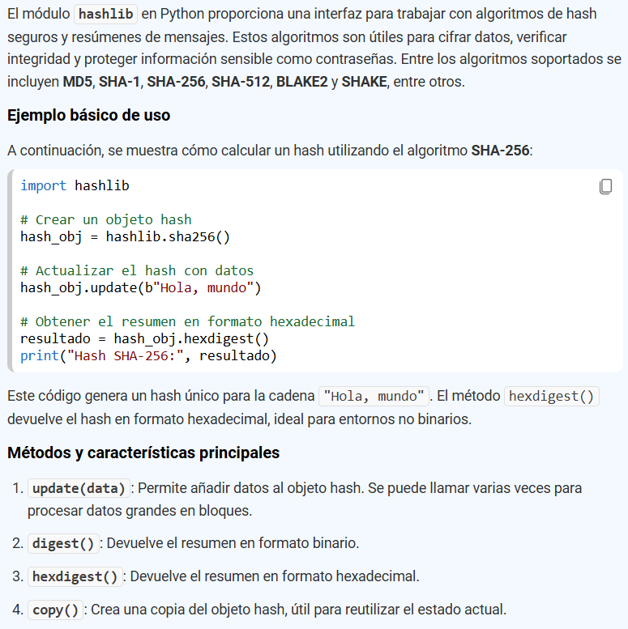
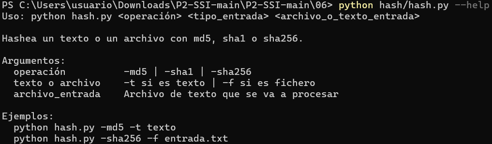
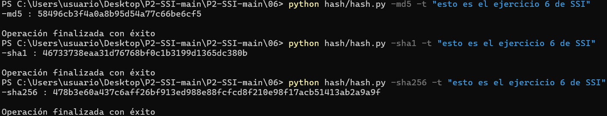
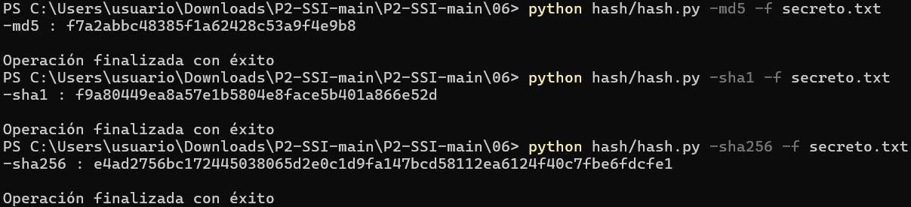
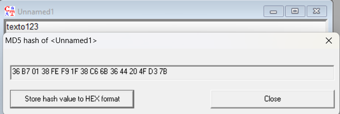
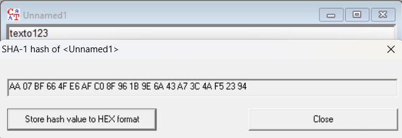
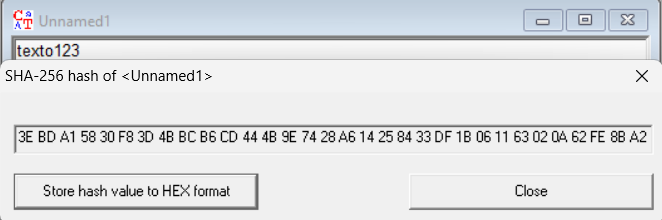
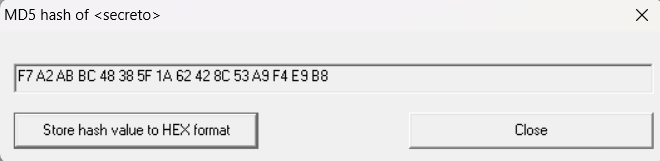
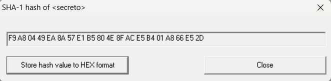
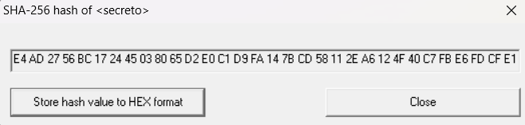

## Ejercicio 6

Utilizando la librería hashlib de Python, desarrollad un programa que permita calcular el hash md5, sha-1 o sha-256 de un texto introducido por pantalla o de un archivo, a elección del usuario (debe incorporar ambas funcionalidades).

### Apartado 6.a

El programa debe poder ejecutarse desde una terminal, invocando al comando `hash.py` y pasándole los argumentos necesarios.

- El parámetro `--help` debe mostrar la sintaxis y las instrucciones de uso, indicando el formato de cada argumento. Mostrad en la memoria una captura de pantalla que incluya la salida del comando con este parámetro.
- Guardad el código implementado dentro de la carpeta `06/hash`.

#### Respuesta 6.a

* [x] Guardado el código fuente `hash.py` en la carpeta `06/hash` para su entrega con esta memoria <!-- CASILLA 6.a -->

<!-- INICIO RESPUESTA -->
Seguimos una estructura basada en una función auxiliar que hace el hashing llamando a la librería hashlib. Para entender como funcionaba buscamos en Internet cómo usarla y nos dió el siguiente resultado: 
A partir de esa respuesta probamos a usar esa misma estructura en nuestra práctica con los 3 algoritmos.
La cobertura de texto y fichero y de los 3 algoritmos requeridos la proporcionamos en el main.

Salida del comando de ayuda: `python hash/hash.py --help`

- 

Por último mostraremos la salida de nuestro programa con los 3 algoritmos tanto si queremos hashear un texto o un fichero:

El comando para hashear el texto `esto es el ejercicio 6 de SSI` es el siguiente: `python hash/hash.py -<algoritmo> -t "esto es el ejercicio 6 de SSI"`
- 

El comando para hashear el fichero `secreto.txt` es el siguiente: `python hash/hash.py -<algoritmo> -f secreto.txt`

- 

### Uso de IA generativa en esta parte
Acerca del main hay un detalle importante a destacar: para procesar la entrada de ficheros, en prácticas previas poníamos modo read "r" con una función .strip() para eliminar espacios. Aquí debimos eliminar eso y procesar por byte "rb" ya que los espacios debemos procesarlos también. 
Al principio nos equivocamos en eso y al ver que no nos daba el resultado de Cryptool, preguntamos a la IA GeminiPro qué podía pasar y nos sugirió esto. Fue un detalle que pasamos por alto ya que el código es reutilizado de prácticas anteriores y no pensamos que el problema estuviese en cómo procesar la entrada.
<!-- FIN RESPUESTA -->

### Apartado 6.b

Comprobad con la ayuda de QuickHash GUI o de CrypTool 1, que vuestra implementación es correcta y mostrad evidencia de ello.

#### Respuesta 6.b

<!-- INICIO RESPUESTA -->
Ahora vamos a contrastar de 1 en 1 las salidas de las 6 situaciones posibles con Cryptool para comprobar que coinciden. En Cryptool para realizar el hashing tenemos que realizar lo siguiente:
1- Seleccionar texto o archivo deseado.
2- Indiv.Procedures --> Hash --> Algoritmo

Primero vamos a comprobar con las imágenes de arriba la salida para el texto: "texto123"
#### MD5

#### SHA-1

#### SHA-256

Ahora vamos a comprobar la salida del hash del fichero secreto.txt
#### MD5

#### SHA-1

#### SHA-256

Vemos que todas coinciden, por lo que concluimos que nuestro código es válido.

<!-- FIN RESPUESTA -->
