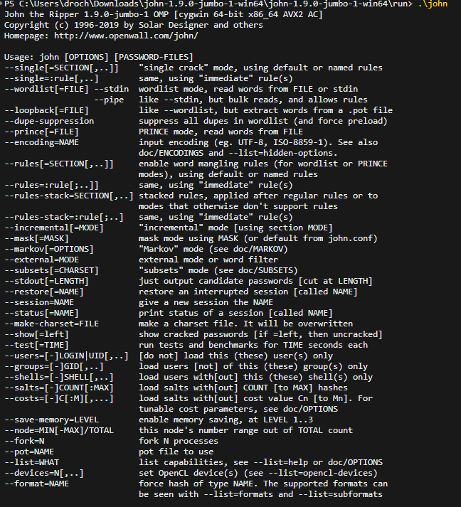
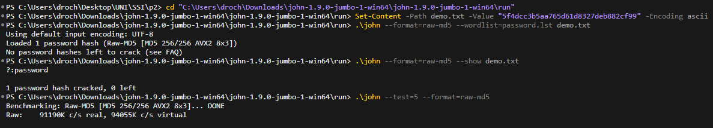
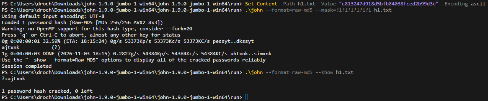

## Ejercicio 8

Instalad la herramienta [John the Ripper](https://www.openwall.com/john/) (JtR) en su versión “jumbo”.

### Apartado 8.a

Probad las opciones básicas y mostrad evidencia de ello.

#### Respuesta 8.a

<!-- INICIO RESPUESTA -->

Se ha instalado **John the Ripper 1.9.0-jumbo-1** (versión *community-enhanced*, que incluye el soporte de MD5 crudo y los ataques por máscara que se usan en 8.b). En Windows se descarga el *build* de 64 bits de openwall y se ejecuta `john.exe` desde la carpeta `run/`.

> En PowerShell, los programas de la carpeta actual se invocan con `.\john` (no basta con `john`).

Ejecutando `.\john` sin argumentos se muestra la versión y el resumen de opciones:




Opciones básicas más habituales:

| Opción | Para qué sirve |
|---|---|
| `.\john --test` | Benchmark: mide los hashes por segundo de cada formato en este equipo |
| `.\john --wordlist=FICHERO hashes.txt` | Ataque por diccionario |
| `.\john --incremental hashes.txt` | Ataque por fuerza bruta incremental |
| `.\john --mask=?l?l?l?l?l?l hashes.txt` | Fuerza bruta con máscara (longitud y conjunto de caracteres fijos) |
| `.\john --show hashes.txt` | Muestra las contraseñas ya crackeadas (guardadas en `john.pot`) |
| `.\john --format=raw-md5 ...` | Indica que los hashes son MD5 crudo (sin *salt*) |

**Evidencia de uso.** Para probar las opciones básicas se crackea por diccionario un hash MD5 de ejemplo (`5f4dcc3b5aa765d61d8327deb882cf99`, que corresponde a la palabra `password`), usando el diccionario `password.lst` incluido en JtR:

```bash
Set-Content -Path demo.txt -Value "5f4dcc3b5aa765d61d8327deb882cf99" -Encoding ascii
.\john --format=raw-md5 --wordlist=password.lst demo.txt
.\john --format=raw-md5 --show demo.txt
.\john --test=5 --format=raw-md5
```

- **`--wordlist`** recorre el diccionario y encuentra la contraseña `password`. En la captura aparece el mensaje *"No password hashes left to crack"* porque el hash ya estaba resuelto de una ejecución previa (guardado en `john.pot`).
- **`--show`** confirma la contraseña recuperada: `demo.txt:password`.
- **`--test=5`** ejecuta un *benchmark* de 5 segundos del formato Raw-MD5.



<!-- FIN RESPUESTA -->

### Apartado 8.b

Utilizad la herramienta para crackear el hash `h1`, suponiendo que el atacante conoce la longitud de la cadena original (6 letras) y el conjunto de caracteres utilizado (sólo minúsculas y sin ñ). Describid las características de la máquina en la que se ejecuta JtR (procesador, RAM, tarjeta gráfica, SO, ...), el comando utilizado y el número de hashes por segundo que puede probar. ¿Cuánto tarda en crackear el hash?

#### Respuesta 8.b

<!-- INICIO RESPUESTA -->

**Hash a crackear** (calculado en el ejercicio 7):

```
h1 = c813247d918d5bfb84038fced2b99d3e
```

**Características de la máquina:**

| Componente | Valor |
|---|---|
| Procesador | Intel Core i7-13700H (13ª gen.), 14 núcleos / 20 hilos |
| Memoria RAM | 16 GB |
| Tarjeta gráfica | NVIDIA GeForce RTX 4060 Laptop + Intel Iris Xe (integrada) |
| Sistema operativo | Windows 11 Home (versión 10.0.26300) |

<!-- Nota: estos datos son del equipo donde se ha ejecutado JtR. Cada integrante debe ajustarlos a SU equipo si lo ejecuta en otro distinto, porque la tasa de hashes/s depende del hardware. -->

**Número de hashes por segundo.** Se mide con el *benchmark* del propio JtR sobre el formato `raw-md5`:

```bash
.\john --test --format=raw-md5
```

```
Benchmarking: Raw-MD5 [MD5 256/256 AVX2 8x3]... DONE
Raw:    59740K c/s real, 60786K c/s virtual
```

La tasa es **R ≈ 59 740 000 hashes/s** (≈ 5,97·10⁷ h/s), usando la cifra *real*. Esta es la implementación por CPU (AVX2); se usa como `R` en los cálculos de este apartado y del 8.c.

> La tasa del *benchmark* fluctúa entre ejecuciones según la carga y la frecuencia del procesador (en el 8.a, un `--test=5` marcó ≈ 91 000K c/s). Se toma como `R` el valor medido en la misma sesión que el crackeo de `h1`; el orden de magnitud es el mismo y no cambia las conclusiones.

**Comando utilizado.** Se guarda el hash en un fichero `h1.txt` y se lanza un ataque por máscara, ya que se conoce la longitud (6) y el conjunto de caracteres (minúsculas, `?l`):

```bash
Set-Content -Path h1.txt -Value "c813247d918d5bfb84038fced2b99d3e" -Encoding ascii
.\john --format=raw-md5 --mask=?l?l?l?l?l?l h1.txt
.\john --format=raw-md5 --show h1.txt
```

**Resultado.** JtR encuentra la contraseña `ajtxnk` en **3 segundos**:

```
1g 0:00:00:03 DONE (2026-11-03 18:15) ... uhtxnk..simxnk
ajtxnk
...
1 password hash cracked, 0 left
```



**Tiempo de crackeo (teórico vs. real).** El espacio de búsqueda de `h1` es:

```
N(h1) = 26^6 = 308 915 776 ≈ 3,09 · 10^8 combinaciones
```

El tiempo máximo (recorriendo todo el espacio) es `t = N / R = 3,09·10^8 / 5,97·10^7 ≈ 5,2 s`, y de media la mitad (≈ 2,6 s). El tiempo real medido (**3 s**) encaja en ese rango. Con MD5, que es muy rápido, una contraseña de 6 minúsculas se rompe de forma casi inmediata.

<!-- FIN RESPUESTA -->

### Apartado 8.c

Teniendo en cuenta los datos del apartado anterior, calculad <u>matemáticamente</u> cuánto se tardaría en crackear los hashes `h2` y `h3` en la misma máquina, suponiendo que el atacante conoce la longitud de la cadena original y el conjunto de caracteres utilizado. ¿Qué conclusión sacáis de los resultados?

#### Respuesta 8.c

<!-- INICIO RESPUESTA -->

Se calcula el tiempo con la misma fórmula `t = N / R`, usando la tasa medida en 8.b:

```
R = 59 740 000 h/s ≈ 5,97 · 10^7 hashes/s
```

No se ejecuta JtR: el cálculo es matemático, suponiendo que el atacante conoce la longitud y el conjunto de caracteres de cada contraseña.

**Espacios de búsqueda:**

- **h2 = `casalibropezmar`** → 15 minúsculas:
  ```
  N(h2) = 26^15 ≈ 1,677 · 10^21 combinaciones
  ```
- **h3 = `C0ruñ4`** → 6 caracteres. El conjunto de caracteres depende de qué suponga el atacante. Tomando el conjunto más amplio (mayúsculas y minúsculas, dígitos, símbolos ASCII y la `ñ`, ≈ 96 caracteres):
  ```
  N(h3) = 96^6 ≈ 7,83 · 10^11 combinaciones
  ```
  <!-- Nota: conviene fijar con el grupo/profesor qué "conjunto de caracteres" se asume para h3. Alternativas:
      26^6 = 3,09·10^8 (solo minúsculas)   -> ~5 s
      36^6 = 2,18·10^9 (minúsculas+dígitos) -> ~36 s
      62^6 = 5,68·10^10 (alfanumérico)      -> ~16 min
      96^6 = 7,83·10^11 (ASCII+ñ)           -> ~3,6 h  <- usado aquí
    Si se cambia, recalcular con t = N / 5,974e7. -->

**Tiempos** (tiempo máximo = N/R; de media, la mitad):

| Hash | Combinaciones N | t = N/R | Tiempo legible (máx.) |
|---|---|---|---|
| h1 (`ajtxnk`, 26⁶) | 3,09 · 10⁸ | 5,2 s | 5,2 s (medido: 3 s) |
| h3 (`C0ruñ4`, 96⁶) | 7,83 · 10¹¹ | 1,31 · 10⁴ s | ≈ 3,6 horas |
| h2 (`casalibropezmar`, 26¹⁵) | 1,677 · 10²¹ | 2,81 · 10¹³ s | ≈ 890 000 años |

Cálculo de `h2` paso a paso: `t = 1,677·10^21 / 5,974·10^7 = 2,808·10^13 s`; dividiendo entre 60, 60, 24 y 365,25 → **≈ 8,9·10^5 años**.

**Conclusión:**

- La **longitud** de la contraseña es el factor que más influye, porque entra como exponente. `h2`, pese a usar solo minúsculas, es astronómicamente más difícil que las otras dos: tiene unos **5,4·10¹² veces** más combinaciones que `h1`, y unos **2·10⁹ veces** más que `h3`.
- `h3` parece la más robusta por mezclar mayúsculas, dígitos y símbolos, pero al tener solo 6 caracteres se rompe por fuerza bruta en unas horas. Además, al ser «Coruña» con sustituciones típicas, un ataque por diccionario con reglas la rompería mucho antes.
- La enorme velocidad de MD5 (decenas de millones de hashes por segundo solo con CPU) hace inseguras las contraseñas cortas, independientemente de su complejidad. Por eso las contraseñas deben ser **largas** y almacenarse con funciones **lentas y con *salt*** (bcrypt, Argon2), no con MD5.

**Declaración de uso de IA generativa (ejercicio 8)**

- **Herramienta y modelo:** Claude Code (aplicación de escritorio de Claude), modelo Claude Opus 5.5 (`claude-opus-5-5`).
- **Prompts relevantes:** «haz el ejercicio 8 todo lo que puedas», «Guíame» (instalación de JtR) y «no mostramos evidencia de que usamos las opciones básicas».
- **Uso de la IA:** recogió las características del equipo, propuso los comandos de JtR (benchmark, ataque por máscara y por diccionario), calculó los tiempos de 8.b y 8.c y redactó las respuestas.
- **Revisión, adaptación y validación:** el estudiante instaló John the Ripper, ejecutó personalmente el *benchmark* y los crackeos (h1 por máscara y la demostración por diccionario) e hizo las capturas. El resultado real (h1 en 3 s) concuerda con el cálculo teórico. **[COMPLETAR antes de entregar: añadir cualquier comprobación adicional del estudiante y eliminar esta nota.]**

<!-- FIN RESPUESTA -->
