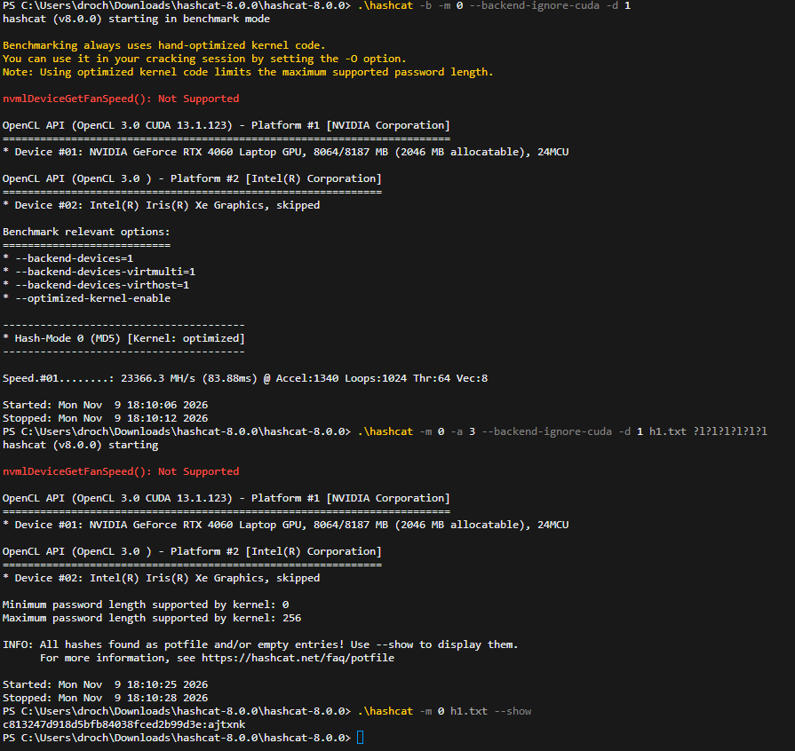
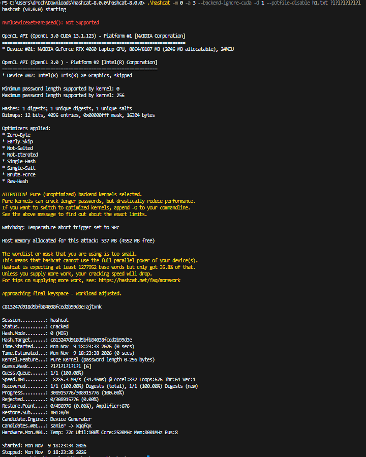

## Ejercicio 9

Instalad la herramienta [hashcat](https://hashcat.net/hashcat/).

### Apartado 9.a

Realizad de nuevo los apartados a) y b) del ejercicio anterior, <u>en la misma máquina</u>, pero utilizando ahora hashcat, en lugar de JtR.

#### Respuesta 9.a

<!-- INICIO RESPUESTA -->

Se instala **hashcat** descargando el archivo binario de https://hashcat.net/hashcat/ y descomprimiéndolo. A diferencia de JtR (que en 8.b trabajó por CPU), hashcat usa la **GPU** del equipo (NVIDIA GeForce RTX 4060) mediante CUDA/OpenCL, por lo que la tasa de hashes por segundo es muy superior. La máquina es la misma del ejercicio 8:

| Componente | Valor |
|---|---|
| Procesador | Intel Core i7-13700H (13ª gen.), 14 núcleos / 20 hilos |
| Memoria RAM | 16 GB |
| Tarjeta gráfica | NVIDIA GeForce RTX 4060 Laptop |
| Sistema operativo | Windows 11 Home (versión 10.0.26300) |

> En PowerShell, el ejecutable de la carpeta actual se invoca con `.\hashcat`.

#### Equivalente al 8.a: opciones básicas

| Opción | Para qué sirve |
|---|---|
| `.\hashcat --version` | Muestra la versión instalada |
| `.\hashcat --help` | Lista los modos de ataque y de hash |
| `.\hashcat -b -m 0` | Benchmark del modo 0 (MD5): mide los hashes/s |
| `.\hashcat -m 0 -a 3 hashes.txt ?l?l?l?l?l?l` | Ataque por máscara (fuerza bruta) |
| `.\hashcat -m 0 -a 0 hashes.txt diccionario.txt` | Ataque por diccionario |
| `.\hashcat -m 0 hashes.txt --show` | Muestra las contraseñas ya crackeadas |

Donde `-m 0` = MD5, `-a 3` = ataque por máscara, `-a 0` = ataque por diccionario y `?l` = una letra minúscula.



En la captura se usan los modificadores `--backend-ignore-cuda -d 1` para que hashcat use directamente OpenCL sobre la RTX 4060 y no muestre los avisos del *toolkit* CUDA.

#### Equivalente al 8.b: crackeo de h1

**Hash** (el mismo del ejercicio 7): `h1 = c813247d918d5bfb84038fced2b99d3e`

Se conoce la longitud (6) y el conjunto de caracteres (minúsculas). Comando:

```bash
Set-Content -Path h1.txt -Value "c813247d918d5bfb84038fced2b99d3e" -Encoding ascii
.\hashcat -m 0 -a 3 h1.txt ?l?l?l?l?l?l
.\hashcat -m 0 h1.txt --show
```

El resultado esperado es `c813247d918d5bfb84038fced2b99d3e:ajtxnk`.

**Número de hashes por segundo.** Se obtiene del *benchmark* del modo 0 (MD5):

```bash
.\hashcat -b -m 0
```

```
* Device #01: NVIDIA GeForce RTX 4060 Laptop GPU, 8064/8187 MB, 24MCU
Hash-Mode 0 (MD5) [Kernel: optimized]
Speed.#01........: 24203.8 MH/s
```

La velocidad medida es **R ≈ 24 203,8 MH/s ≈ 24,2 GH/s** (2,42·10¹⁰ hashes/s) sobre la GPU.

> Nota: hashcat avisa de que el *toolkit* CUDA está desactualizado y recurre a OpenCL (`Falling back to OpenCL`). No es un error: el ataque se ejecuta igualmente sobre la RTX 4060.

**Tiempo de crackeo de h1.** Con `N(h1) = 26^6 ≈ 3,09·10^8` combinaciones:

```
t = N / R = 3,09·10^8 / 2,42·10^10 ≈ 0,013 s (≈ 13 ms)
```

Es prácticamente instantáneo.

**Resultado real.** hashcat crackea `h1` en **0 segundos**:

```
c813247d918d5bfb84038fced2b99d3e:ajtxnk
Status...........: Cracked
Recovered........: 1/1 (100.00%) Digests
Progress.........: 308915776/308915776 (100.00%)
Time.Started.....: ... (0 secs)
```



> El ataque se lanzó con `--potfile-disable` para forzar el crackeo (el hash ya estaba resuelto de una prueba previa). En esta pasada hashcat avisa de que el espacio de búsqueda (26⁶) es demasiado pequeño para aprovechar toda la GPU (usó ~36 %), por lo que la velocidad del *ataque* (≈ 8,3 GH/s) es menor que la del *benchmark* (≈ 24 GH/s). Aun así, se rompe en menos de 1 segundo.

#### Comparación con John the Ripper (ejercicio 8)

| Herramienta | Dispositivo | Velocidad (MD5) | Tiempo para h1 (26⁶) |
|---|---|---|---|
| John the Ripper | CPU (i7-13700H, AVX2) | ≈ 59,7 MH/s | ≈ 3 s (medido) |
| hashcat | GPU (RTX 4060) | ≈ 24 203,8 MH/s | ≈ 13 ms (teórico) |

**Conclusión.** hashcat sobre GPU es **unas 405 veces más rápido** que JtR sobre CPU para MD5 (24,2 GH/s frente a 59,7 MH/s), porque la GPU paraleliza miles de operaciones a la vez. Esto refuerza la conclusión del ejercicio 8: MD5 es demasiado rápido de calcular y las contraseñas cortas (como `h1`) caen por fuerza bruta de forma casi inmediata, y con hardware gráfico aún más. Por eso las contraseñas deben ser largas y almacenarse con funciones lentas y con *salt* (bcrypt, Argon2), no con MD5.

**Declaración de uso de IA generativa (ejercicio 9)**

- **Herramienta y modelo:** Claude Code, modelo Claude Opus 4.8.
- **Uso de la IA:** propuso los comandos de hashcat (benchmark y ataque por máscara), ayudó a resolver los errores de arranque (ruta del ejecutable y avisos de CUDA) y calculó la comparación de velocidad con JtR.

<!-- FIN RESPUESTA -->
