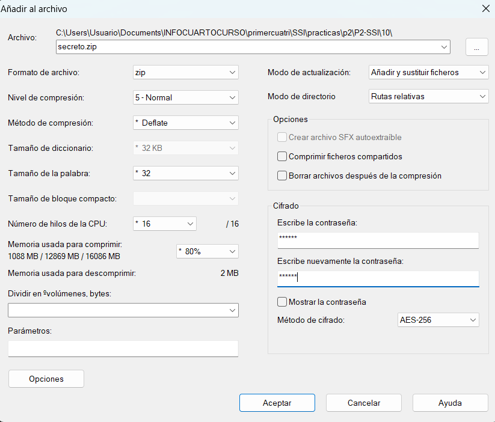
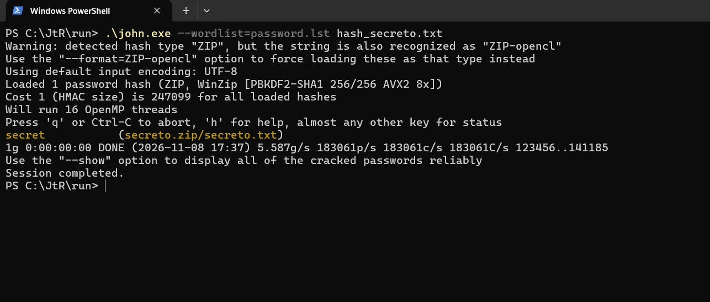
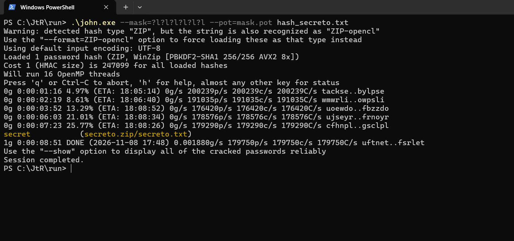
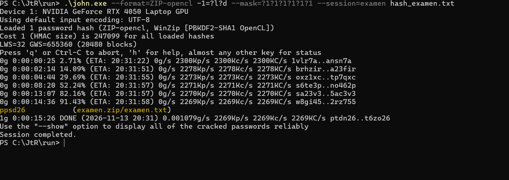

## Ejercicio 10

Utilizando 7-Zip generad un archivo comprimido protegido con contraseña, teniendo en cuenta lo siguiente:

- El algoritmo de compresión debe ser `.zip`.
- La contraseña debe ser de 6 letras (sólo minúsculas y sin ñ).
- El algoritmo de cifrado debe ser AES.
- Tomad como base el archivo `secreto.txt` disponible en el Campus Virtual.

### Apartado 10.a

Documentad el proceso.

#### Respuesta 10.a

<!-- INICIO RESPUESTA -->

Tomando como base el archivo `secreto.txt` (de 1 MB de tamaño), se utilizó la herramienta gráfica **7-Zip** para generar el archivo comprimido cifrado `secreto.zip` siguiendo los requisitos del enunciado:

1. **Selección del archivo y compresión:**
   - Se seleccionó el archivo `secreto.txt`, haciendo clic derecho sobre él y seleccionando **7-Zip → Añadir al archivo...**
   - En el desplegable **Formato de archivo**, se modificó el valor por defecto (`7z`) para seleccionar obligatoriamente **`zip`**.
   - Se mantuvo el nivel de compresión estándar (*Normal / Deflate*).

2. **Configuración de la contraseña y algoritmo de cifrado:**
   - En la sección **Cifrado**, se introdujo una contraseña de exactamente 6 letras minúsculas (sin 'ñ'): `secret`.
   - En el desplegable **Método de cifrado**, se seleccionó **`AES-256`** en lugar del método tradicional *ZipCrypto*.

3. **Justificación criptográfica de la elección de AES:**
   - El método clásico de los archivos ZIP (*ZipCrypto*) es obsoleto e inseguro: presenta debilidades estructurales conocidas (ataque de texto plano conocido de Biham y Kocher) que permiten deducir las claves internas y descifrar el contenido en cuestión de minutos disponiendo de unos pocos bytes conocidos.
   - En contraste, el estándar **WinZip AES-256** emplea el algoritmo simétrico por bloques AES con claves de 256 bits y una función de derivación de claves basada en **PBKDF2** (con HMAC-SHA1 y 1.000 iteraciones), lo que proporciona una seguridad computacionalmente robusta frente a ataques directos y ralentiza deliberadamente los ataques por fuerza bruta.



Una vez verificados todos los parámetros reflejados en la captura anterior, se pulsó **Aceptar**, generándose el archivo comprimido cifrado `secreto.zip`.

<!-- FIN RESPUESTA -->

### Apartado 10.b

Utilizad JtR para intentar obtener la contraseña. En este caso ya conocéis la contraseña, por lo que se trata únicamente de probar que la herramienta funciona. Probad la opción de ataque por diccionario y también la opción de ataque dirigido, indicando a la herramienta datos como la longitud de la contraseña o el conjunto de caracteres utilizado. Indicad los comandos utilizados y mostrad capturas de pantalla de los resultados obtenidos.

#### Respuesta 10.b

<!-- INICIO RESPUESTA -->

Para realizar las pruebas de recuperación de la contraseña se empleó **John the Ripper (JtR) Jumbo**.

#### 1. Extracción del hash con `zip2john`
John the Ripper no ataca directamente el archivo binario comprimido, sino que requiere extraer previamente el hash criptográfico del archivo ZIP. Para ello se utilizó la utilidad auxiliar `zip2john` incluida en la subcarpeta `run/` de JtR:

```bash
zip2john secreto.zip > hash_secreto.txt
```

El archivo `hash_secreto.txt` generado almacena el identificador `$zip2$...*AES*...`, confirmando que el archivo utiliza el esquema de protección WinZip AES (PBKDF2-SHA1).

---

#### 2. Ataque por diccionario
Para la primera prueba se utilizó el diccionario de contraseñas estándar `password.lst` que acompaña a John the Ripper. Se invocó la herramienta indicando dicho diccionario:

```bash
john --wordlist=password.lst hash_secreto.txt
```

Al estar la palabra elegida (`secret`) incluida en la lista, JtR reconoció la correspondencia de forma prácticamente inmediata (menos de 1 segundo de ejecución) a una velocidad de más de 183.000 comparaciones/segundo utilizando 16 hilos:

```
secret (secreto.zip/secreto.txt)
1g 0:00:00:00 DONE 5.587g/s 183061p/s 183061c/s 183061C/s
```

A continuación se muestra la evidencia de la ejecución del ataque por diccionario:



---

#### 3. Ataque dirigido (por máscara)
Para la segunda prueba se realizó un ataque dirigido donde se le indicaron a JtR las restricciones conocidas sobre la clave:
- **Longitud fija de 6 caracteres**.
- **Juego de caracteres**: únicamente letras minúsculas inglesas sin ñ (representadas por el especificador `?l` en la sintaxis de máscaras de John, formando la máscara `?l?l?l?l?l?l`).

Dado que la contraseña ya había sido crackeada en el paso anterior y registrada en `john.pot`, se utilizó el parámetro `--pot=mask.pot` para forzar a la herramienta a realizar la búsqueda por máscara desde cero sin leer los resultados cacheados:

```bash
john --mask=?l?l?l?l?l?l --pot=mask.pot hash_secreto.txt
```

**Parámetros y rendimiento del ataque dirigido:**
- **Espacio de búsqueda total:** $26^6 = 308.915.776$ combinaciones posibles.
- **Rendimiento medio:** ~180.000 comparaciones por segundo (utilizando 16 hilos OpenMP sobre procesador multinúcleo con instrucciones AVX2).
- **Resultado:** JtR exploró el espacio alfabéticamente hasta alcanzar las combinaciones que empiezan por la letra `s` (aproximadamente un 25,8% del espacio de búsqueda total), encontrando con éxito la contraseña `secret` en un tiempo de **8 minutos y 51 segundos**:

```
secret (secreto.zip/secreto.txt)
1g 0:00:08:51 DONE 0.001880g/s 179750p/s 179750c/s 179750C/s uftnet..fsrlet
```

A continuación se muestra la captura de la consola con la evolución y finalización del ataque dirigido:



---

#### 4. Comparación entre ambos métodos
- **Ataque por diccionario:** Es extremadamente rápido (fracciones de segundo) y computacionalmente eficiente, pero depende estrictamente de que la clave figure en la lista de palabras utilizada.
- **Ataque dirigido por máscara:** Evalúa metódicamente las combinaciones dentro del espacio definido. Aunque requiere un coste temporal notablemente mayor debido a las 1.000 iteraciones de PBKDF2 del estándar AES (unos 9 minutos frente al instante del diccionario), garantiza el hallazgo de la contraseña al acotar el espacio a $26^6$, evitando el coste prohibitivo de una fuerza bruta completa sobre todo el espectro ASCII.

<!-- FIN RESPUESTA -->

### Apartado 10.c

Utilizando lo aprendido, intentad obtener la contraseña del archivo `examen.zip`, disponible en el Campus Virtual.

#### Respuesta 10.c

<!-- INICIO RESPUESTA -->

**1. Extracción del hash:**
En primer lugar se extrajo el hash criptográfico del archivo `examen.zip` utilizando `zip2john`:

```bash
zip2john examen.zip > hash_examen.txt
```

**2. Estrategia y optimización del ataque:**
Al no obtener resultado mediante diccionario ni con máscaras de solo letras, se planteó un ataque dirigido acotado a 6 caracteres alfanuméricos (letras minúsculas y números: $36^6 \approx 2,17 \cdot 10^9$ combinaciones). 

En CPU (a ~180.000 c/s) este espacio habría requerido más de 3 horas de computación continua. Para optimizar la búsqueda se aprovechó la GPU (NVIDIA GeForce RTX 4050) mediante OpenCL:

```bash
john --format=ZIP-opencl -1=?l?d --mask=?1?1?1?1?1?1 --session=examen hash_examen.txt
```

- `--format=ZIP-opencl`: procesa el algoritmo PBKDF2/AES en los núcleos de la GPU, aumentando drásticamente la tasa de hashes por segundo.
- `-1=?l?d`: define un conjunto restringido a 36 caracteres (minúsculas `?l` y dígitos `?d`), descartando mayúsculas y caracteres especiales para no disparar el tiempo.
- `--mask=?1?1?1?1?1?1`: fija la longitud exacta a 6 caracteres sobre dicho conjunto.
- `--session=examen`: guarda el progreso en disco para pausar o reanudar el ataque en cualquier momento con `john --restore=examen`.

**3. Resultado obtenido:**
Gracias a la aceleración por GPU, la velocidad subió a **~2.270.000 comparaciones/segundo** (más de 12 veces más rápido que la CPU). La contraseña se obtuvo con éxito en **15 minutos y 26 segundos**:

- **Contraseña obtenida:** **`ppsd26`**
- **Comprobación:** al introducir `ppsd26` en 7-Zip, el archivo `examen.zip` se descomprime correctamente, extrayéndose el fichero interior `examen.txt`.



<!-- FIN RESPUESTA -->
