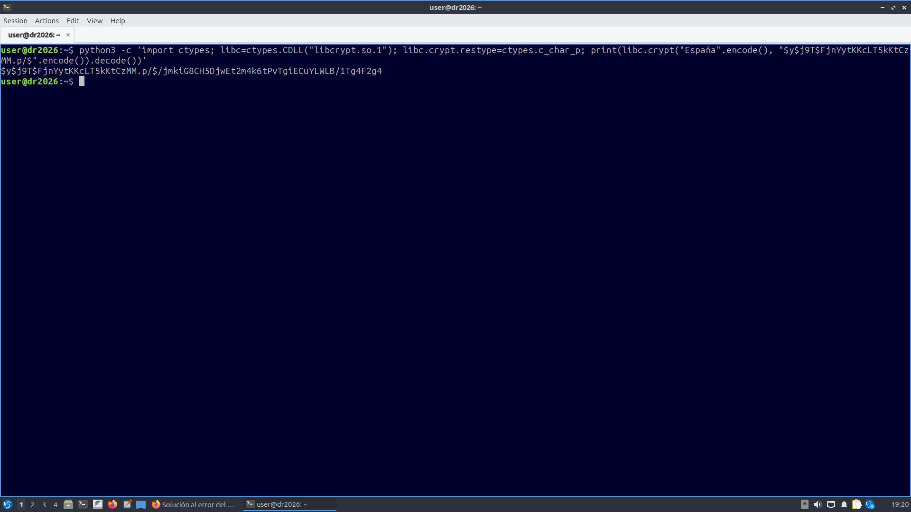
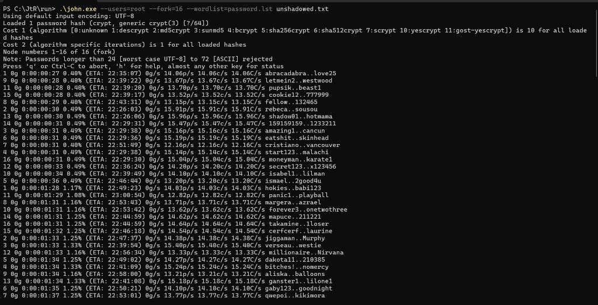
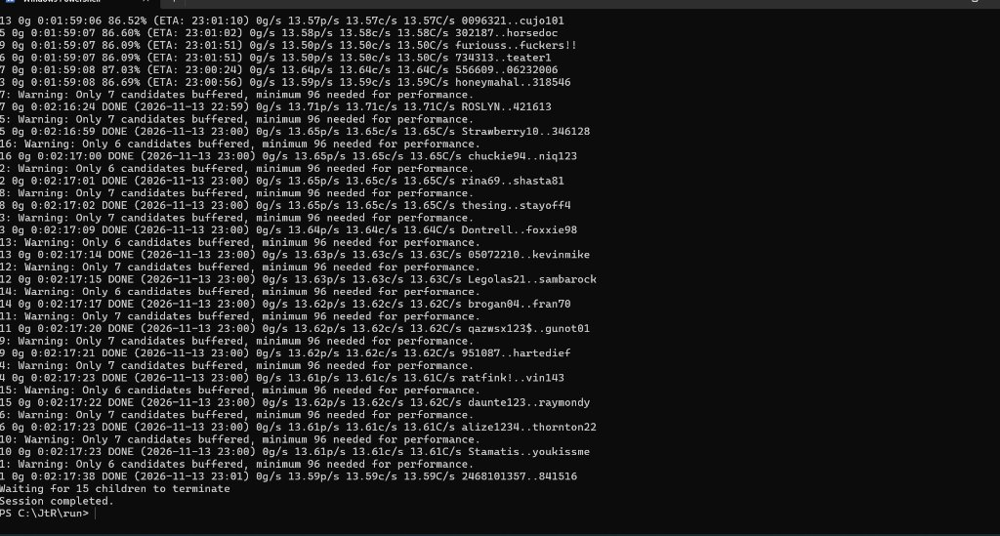

## Ejercicio 11

Revisad los archivos `passwd` y `shadow` disponibles en Campus Virtual y realizad lo siguiente:

### Apartado 11.a

Indicad cuál es el objetivo de esos archivos y explicad el formato detallado de los mismos (los campos que contienen y qué significa cada campo).

#### Respuesta 11.a

<!-- INICIO RESPUESTA -->

**Objetivo de los archivos:**
- **`/etc/passwd`:** Almacena la configuración básica de todas las cuentas de usuario del sistema. Es legible por cualquier usuario y proceso (`rw-r--r--`).
- **`/etc/shadow`:** Almacena los hashes de las contraseñas cifradas y la información de caducidad. Es accesible únicamente por el superusuario `root` (`rw-r-----` o `rw-------`), aislando los hashes para impedir que usuarios sin privilegios realicen ataques de diccionario o fuerza bruta offline.

**Formato de `/etc/passwd` (7 campos delimitados por `:`):**
1. **Nombre de usuario (`login`):** Identificador de la cuenta (`root`, `pepe`).
2. **Contraseña:** Marcador `x`, que indica que el hash se almacena de forma segura en `/etc/shadow`.
3. **UID (`User ID`):** Identificador numérico del usuario (`0` para root; $\ge 1000$ para usuarios estándar).
4. **GID (`Group ID`):** Identificador del grupo principal al que pertenece el usuario.
5. **GECOS:** Información descriptiva o personal del usuario (nombre completo, teléfono, etc.).
6. **Directorio personal (`home`):** Ruta absoluta de su directorio de inicio (`/root`, `/home/pepe`).
7. **Shell de inicio:** Intérprete de comandos asignado al iniciar sesión (`/bin/bash` o `/usr/sbin/nologin` si es una cuenta de servicio sin acceso interactivo).

**Formato de `/etc/shadow` (9 campos delimitados por `:`):**
1. **Nombre de usuario:** Identificador de la cuenta que coincide con `passwd`.
2. **Contraseña cifrada:** Hash de la clave (o `*`/`!` si la cuenta está bloqueada/sin login).
3. **Último cambio de contraseña:** Días transcurridos desde el 1 de enero de 1970 (época Unix) hasta el último cambio (`20025` días).
4. **Días mínimos:** Tiempo mínimo que debe transcurrir antes de poder cambiar la contraseña (`0`).
5. **Días máximos:** Tiempo máximo de validez de la contraseña antes de obligar a renovarla (`99999`).
6. **Periodo de aviso:** Días de antelación con los que se alerta al usuario de la expiración (`7`).
7. **Periodo de inactividad:** Días tras caducar la clave antes de deshabilitar la cuenta (vacío).
8. **Fecha de expiración:** Fecha absoluta de vencimiento de la cuenta en días desde la época Unix (vacío).
9. **Reservado:** Campo reservado para uso futuro (vacío).

<!-- FIN RESPUESTA -->

### Apartado 11.b

¿Qué algoritmo de hash se está utilizando?

#### Respuesta 11.b

<!-- INICIO RESPUESTA -->

Se está utilizando **yescrypt** (una función de derivación de claves basada en *scrypt*).

Se identifica por el prefijo **`$y$`** al comienzo del campo de contraseña en el archivo `shadow` (en concreto `$y$j9T$...`). Es el algoritmo de hashing por defecto en distribuciones modernas de Linux debido a su resistencia frente a ataques acelerados por GPU y ASIC gracias a su consumo configurable de memoria y cómputo.

<!-- FIN RESPUESTA -->

### Apartado 11.c

¿Cuál es el propósito del campo “*salt*”?

#### Respuesta 11.c

<!-- INICIO RESPUESTA -->

El *salt* es una cadena aleatoria que se concatena a la contraseña antes de calcular el hash. Su propósito es:

1. **Evitar ataques con tablas precalculadas (*Rainbow Tables*):** Garantiza que dos usuarios con la misma contraseña generen hashes completamente diferentes, neutralizando el uso de tablas ya calculadas.
2. **Forzar el ataque individualizado:** Obliga al atacante a computar las pruebas cuenta por cuenta en lugar de probar una misma palabra candidata contra todos los usuarios a la vez, multiplicando linealmente el coste computacional del ataque.

<!-- FIN RESPUESTA -->

### Apartado 11.d

Sabiendo que la contraseña del usuario `pepe` es "`España`" (sin comillas), indicad los pasos para calcular el hash de la contraseña y comprobad si coincide con el que figura en el archivo.

#### Respuesta 11.d

<!-- INICIO RESPUESTA -->

**1. Parámetros del archivo `shadow`:**
En la línea correspondiente a `pepe`:
```
pepe:$y$j9T$FjnYytKKcLT5kKtCzMM.p/$/jmkiG8CH5DjwEt2m4k6tPvTgiECuYLWLB/1Tg4F2g4:20025:0:99999:7:::
```
El prefijo que define el algoritmo (yescrypt, `$y$`), los parámetros de coste (`j9T`) y el *salt* (`FjnYytKKcLT5kKtCzMM.p/`) es:
```
$y$j9T$FjnYytKKcLT5kKtCzMM.p/$
```

**2. Pasos para el cálculo:**
Desde una máquina virtual con Linux, se utiliza Python invocando directamente la función estándar `crypt` de la librería del sistema (`libcrypt.so.1` vía `ctypes`), pasando la contraseña en UTF-8 y el bloque de configuración/salt:

```bash
python3 -c 'import ctypes; libc=ctypes.CDLL("libcrypt.so.1"); libc.crypt.restype=ctypes.c_char_p; print(libc.crypt("España".encode(), "$y$j9T$FjnYytKKcLT5kKtCzMM.p/$".encode()).decode())'
```

**3. Comprobación:**
La salida obtenida en la máquina virtual es:
```
$y$j9T$FjnYytKKcLT5kKtCzMM.p/$/jmkiG8CH5DjwEt2m4k6tPvTgiECuYLWLB/1Tg4F2g4
```
Se comprueba que el hash generado **coincide exactamente** carácter a carácter con el registrado en el archivo `shadow`.



<!-- FIN RESPUESTA -->

### Apartado 11.e

Utilizad JtR para intentar obtener la contraseña del usuario `root`. Documentad el proceso.

#### Respuesta 11.e

<!-- INICIO RESPUESTA -->

**1. Preparación previa:**
En primer lugar se combinaron los ficheros `passwd` y `shadow` mediante la herramienta `unshadow` de John the Ripper para generar un único archivo con los usuarios y sus respectivos hashes:

```bash
unshadow passwd shadow > unshadowed.txt
```

**2. Comando y opciones utilizadas:**
Para intentar obtener la contraseña de `root` mediante un ataque por diccionario optimizado al máximo en CPU, se ejecutó el siguiente comando:

```bash
john --users=root --fork=16 --wordlist=password.lst unshadowed.txt
```

- `--users=root`: restringe el ataque exclusivamente al usuario `root`, descartando el resto de cuentas (como `pepe`) para no malgastar recursos.
- `--fork=16`: paraleliza el cálculo en 16 procesos independientes para aprovechar los 16 hilos del procesador. Es imprescindible porque `yescrypt` no permite aceleración por GPU (OpenCL) al ser un algoritmo *memory-hard*, ni cuenta con soporte OpenMP directo en esta versión.
- `--wordlist=password.lst`: define el diccionario de contraseñas de John the Ripper.



**3. Resultado obtenido:**
Tras recorrer el 100% del diccionario (un tiempo total de ejecución de **2 horas, 17 minutos y 38 segundos**), **no se consiguió averiguar la contraseña** (`0 password hashes cracked, 1 left`), concluyendo la sesión sin éxito.



**4. Conclusión:**
La contraseña establecida para `root` no figura en el diccionario estándar `password.lst`. Además, debido a la naturaleza de **yescrypt** (diseñado con un alto coste computacional y de memoria RAM para mitigar ataques masivos), la tasa de prueba se situó en unos ~220 hashes/segundo combinando los 16 hilos, lo que convierte cualquier intento de fuerza bruta exhaustiva en una tarea computacionalmente inviable (requeriría meses de cómputo ininterrumpido), demostrando la robustez de este algoritmo para proteger las cuentas del sistema operativo.

<!-- FIN RESPUESTA -->
